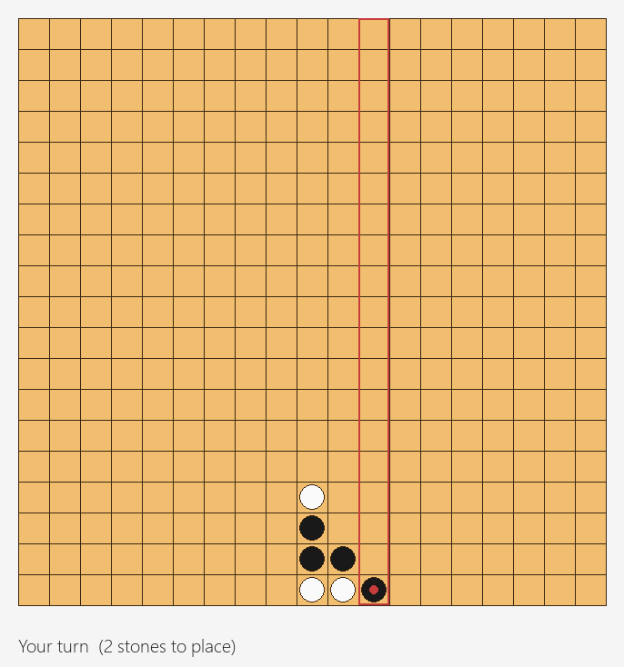

# Connect-6 AI (Alpha-Beta Search)

> Artificial Intelligence coursework, The British University in Egypt, 2024. Author: Ziad Ayman.

A playable **Connect-6** game on a 19 × 19 board against a computer opponent that uses **alpha-beta minimax search**. The game follows the official two-stones-per-turn rule and is played with gravity, as in Connect Four. The AI plans whole two-stone turns, and an automated benchmark measures how search depth changes its strength.



## Rules
- Stones drop to the lowest empty cell of the chosen column.
- The first player places **one** stone on the opening turn; after that, each turn is **two** stones.
- Six in a row (horizontally, vertically or diagonally) wins.

## The AI
- **Turn-level search:** the AI evaluates both stones of a turn together (combinations of the most promising columns) and searches alternating turns with **alpha-beta pruning**.
- **Move ordering and beam:** only the best-scoring columns are expanded, which keeps a 19 × 19 board fast enough for real-time play.
- **Tactics first:** it takes an immediate win if one exists and blocks the opponent's immediate threats before searching.
- **Vectorised evaluation:** every length-6 line on the board is extracted with NumPy sliding windows and scored by how many stones each player has in lines the other player has not blocked.

## Benchmark (20 games per pairing, alternating who moves first)

| Match | Result | Thinking time per stone |
|---|---|---|
| **Depth 2 vs greedy baseline** | **20 wins, 0 losses** | 417 ms vs 18 ms |
| **Depth 2 vs depth 1** | **20 wins, 0 losses** | 412 ms vs 20 ms |
| Depth 1 vs greedy baseline | 10 wins, 10 losses | 20 ms vs 19 ms |

Looking one turn ahead (depth 1) plays at the same level as the greedy baseline, but searching two turns ahead (anticipating the opponent's reply) wins every game. Run it yourself with `python -m connect6.benchmark --games 20`; results are written to [`results/benchmark.json`](results/benchmark.json).

## Getting started
```bash
pip install -r requirements.txt
python -m connect6.gui              # play against the AI (click a column; R to restart)
python -m connect6.gui --depth 1    # faster, weaker AI
python -m pytest -q                 # 12 tests
```

## Project structure
```
connect6/
├── board.py       # board, gravity, O(1) win detection around the last stone, turn rules
├── ai.py          # evaluation, greedy baseline, alpha-beta turn search
├── benchmark.py   # AI vs AI matches
└── gui.py         # pygame interface
tests/             # rules, win detection, turn order, tactics, legality
```

## What changed from the original coursework notebook
- Fixed the drawing offset that placed stones on grid corners (and off the board in the last column).
- Fixed a crash when the AI won with the first stone of its turn and then tried to play a second.
- The AI now plans both stones of a turn instead of one stone at a time, and checks for wins only around the last stone (constant time) instead of rescanning the whole board.
- Split into a package with rules, AI, interface and tests, and added the benchmark.

## Tech stack
Python · NumPy · pygame · pytest
